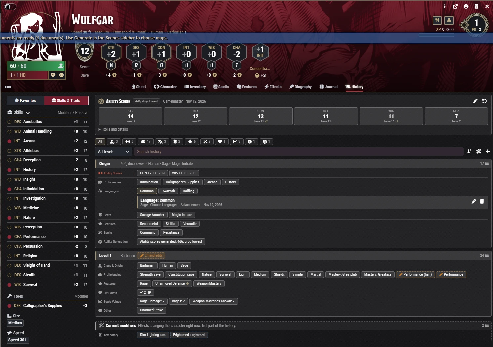
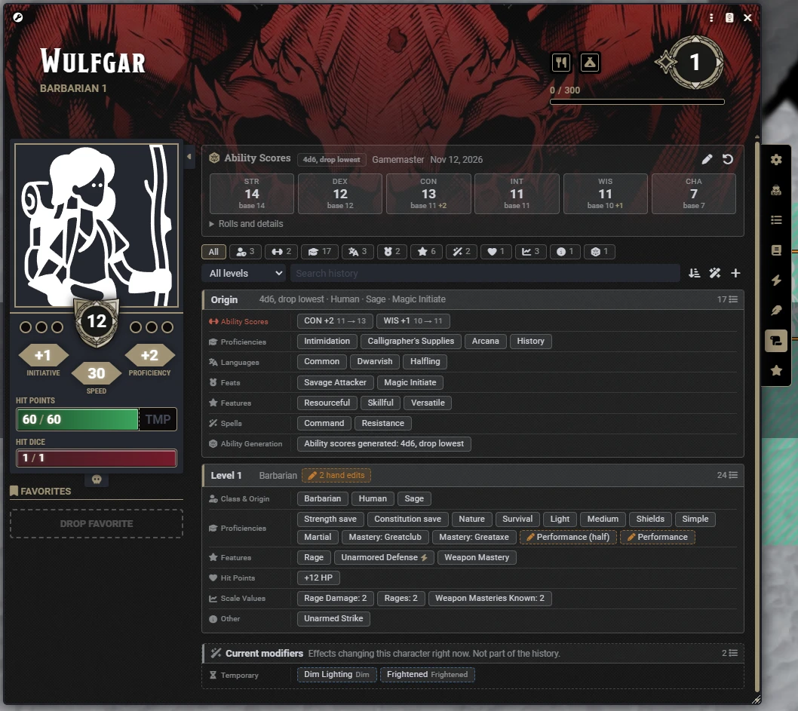

# KG PC History

A History tab for dnd5e characters: how their ability scores were generated, and what every level, species,
background and feat changed.

Foundry v13 with dnd5e 5.3.3+, and Foundry v14 with dnd5e 6.x. Works on the default character sheet and on Tidy 5e.

## Ability scores (optional, off by default)

Ability score generation is an optional extra and starts turned off, since another module may already handle character
creation. The first time a GM loads the world, the module asks whether to turn it on. It can be changed any time in the
module settings. History tracking works either way.

- Point buy, standard array, or rolled. The GM chooses which are allowed.
- Rolling methods: 4d6 drop lowest, reroll 1s (once or always), in order, seven scores drop the lowest, 3d6,
  3d6 in order, 2d6+6, 5d6 keep 3.
- Rolls are made on the GM's client and saved before the player assigns them. The GM sets how many rerolls are
  allowed; discarded sets stay on record.
- Once recorded, only the GM can change the scores. Resetting them requires typing RESET.

## History

- Recorded automatically from dnd5e advancement: ability scores, proficiencies, languages, resistances, features,
  feats, spells, hit points and scale values. Each entry shows the level and what granted it.
- Edits typed on the sheet are recorded as hand edits, with who made them.
- One card per level, filterable by type, class and level, with search.
- Click an ability score to see where it came from: the base, each increase, and any active effects.
- A Current modifiers card lists effects changing the character right now (spells, conditions, equipment). They are
  never recorded unless the GM records one.

## GM tools

- Add, edit or delete entries.
- Edit the generation record of an older character.
- Rebuild an older character's history from the advancement choices dnd5e stores on its items. If it has no
  generation record, Rebuild can work out its base scores (sheet scores minus advancement increases) and guess the
  method. The record is marked Inferred until the GM confirms it. Start over clears the module's own entries and
  rebuilds from scratch, for a character whose class, species or background was replaced. Rebuild is locked until
  the GM unlocks it with the padlock on the History tab, and locks again after one use.
- Set the class order of a multiclass character, which dnd5e does not record.

## Settings

| Setting | Default |
|---|---|
| Allow Point Buy | Off (27 points when on) |
| Allow Standard Array | Off |
| Allow Rolling | Off |
| Rolling Methods | 4d6 drop lowest, when rolling is on |
| Ask for Ability Scores | On creation, and on the player's first open (only when generation is on) |
| Record Advancement | On |
| Record Manual Changes | On |
| Players See the History Tab | On |

## Storage

Each character has one small flag pointing to `worlds/<world>/pc-history/<actorId>.json`. Only the GM's client
writes these files; players' changes go through the GM. With no GM online, changes wait on the character and are
written when a GM logs in.

History files do not travel with characters exported to a compendium or another world. Include the `pc-history`
folder in world backups.

## Install

Manifest URL: `https://github.com/KonteiKeisei/kg-pc-history/releases/latest/download/module.json`

## License

PolyForm Noncommercial 1.0.0. See [LICENSE](LICENSE).
